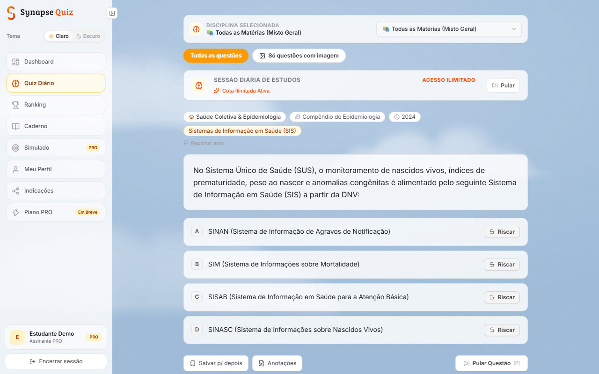
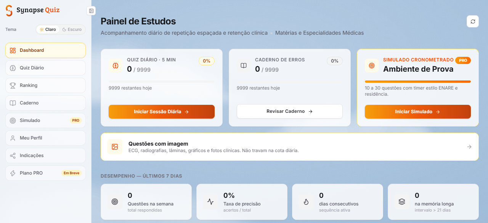
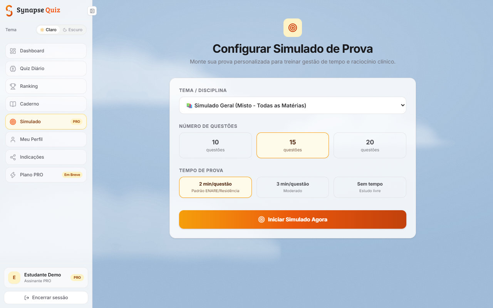
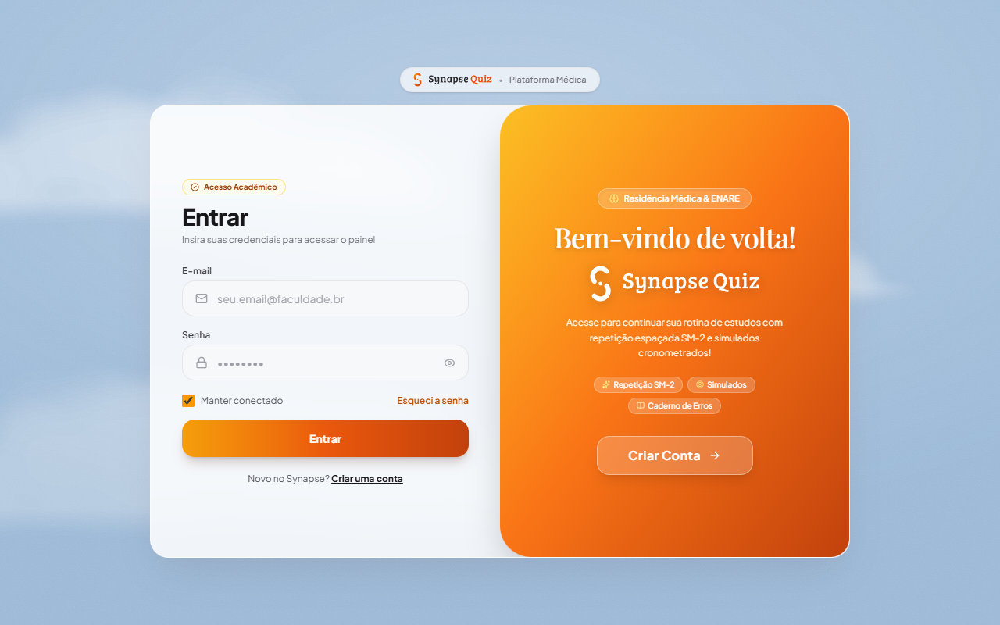
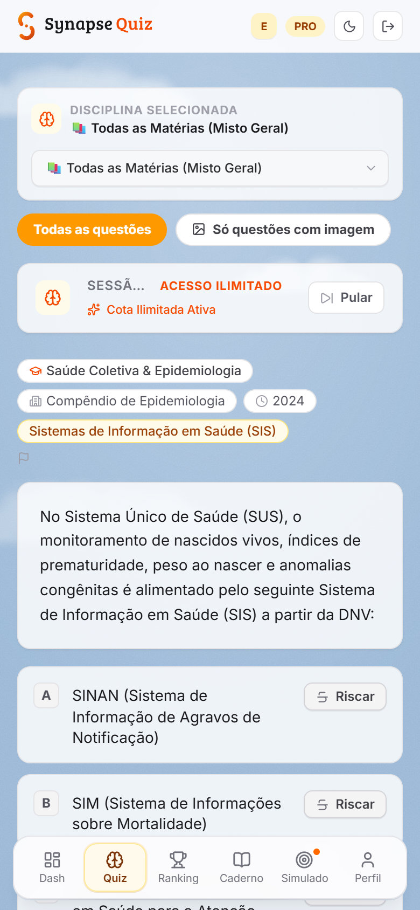

<h1 align="center">Synapse Quiz</h1>

<p align="center">
  Plataforma de estudo para medicina com <strong>repetição espaçada</strong>, simulados cronometrados e ranking de estudantes.
</p>

<p align="center">
  <a href="https://synapse-quiz-ten.vercel.app"><strong>Ver o app online</strong></a>
</p>

<p align="center">
  
  
  
  
  
  
</p>



## O que é

O Synapse Quiz ajuda estudantes de medicina (do 1º período ao internato e à preparação para residência) a estudar com questões que voltam na hora certa. Cada resposta ajusta quando a questão aparece de novo, para fixar o conteúdo com menos esforço.

## Principais recursos

- **Repetição espaçada (SRS):** algoritmo baseado no SM-2. O acerto aumenta o intervalo de revisão e o erro faz a questão voltar em 1 dia.
- **Quiz diário e por disciplina:** mais de 600 questões com gabarito comentado, casos clínicos e imagens clínicas (ECG, radiografias, lâminas).
- **Simulados cronometrados:** prova com tempo no estilo ENARE e residência, com histórico de tentativas e pontuação.
- **Ranking de estudantes:** pódio com os 3 primeiros, pontos por acerto e constância, e filtros por faculdade e período.
- **Caderno de erros e favoritos**, **anotações por questão** e **riscar alternativas** para eliminar opções.
- **Reportar erro de gabarito:** cada questão tem um canal de feedback, com painel de administração.
- **Perfil do estudante:** crachá digital, catálogo de faculdades de medicina e avatares.
- **Conta completa:** cadastro com verificação de e-mail, recuperação de senha e indicação de amigos.
- **PWA:** instalável no computador e no celular, com tema claro e escuro.

| Painel de estudos | Simulado |
|---|---|
|  |  |

| Login | No celular |
|---|---|
|  |  |

## Tecnologias

| Parte | Tecnologia |
|---|---|
| Framework | Next.js 16 (App Router) e React 19 |
| Estilo | Tailwind CSS 4, Radix UI e shadcn |
| Banco de dados | Prisma 6 com SQLite local e Turso (libSQL) em produção |
| Autenticação | Cookie HTTP-only com JWT (`jose`) e senhas com `bcryptjs` |
| E-mail | Nodemailer (verificação de conta e recuperação de senha) |
| Deploy | Vercel |

## Rodar localmente

```bash
npm install
cp .env.example .env          # ajuste JWT_SECRET; o padrão usa SQLite local (file:./dev.db)
npx prisma db push            # cria o banco local
npm run seed                  # popula as questões e cria contas de demonstração (as senhas são impressas no console)
npm run dev                   # http://localhost:3000
```

Sem `SMTP_USER` e `SMTP_PASS`, os e-mails de verificação e recuperação de senha aparecem no console. Em produção, o banco é o Turso (`npm run turso:init`) e o `JWT_SECRET` precisa ser uma chave forte.

## Segurança

- Sessão por cookie HTTP-only assinado com JWT, e senhas guardadas só como hash.
- Verificação de e-mail e recuperação de senha por token de uso único.
- Limite de tentativas (rate limiting) nas rotas sensíveis. `npm run test:security` roda uma auditoria básica contra o servidor local.
- Área de administração restrita aos e-mails definidos em `ADMIN_EMAILS`.
- Nenhuma chave ou senha fica no repositório: tudo vem de variáveis de ambiente (veja `.env.example`).

## Estrutura

```
src/app/        páginas e rotas de API (App Router)
src/lib/        autenticação, SRS (srs.ts), ranking, e-mail e rate limit
prisma/         schema, migrations e lotes de questões
scripts/        manutenção do banco e coleta de imagens clínicas
```

## Sobre o conteúdo

As questões foram geradas com IA (Claude e Gemini) e podem conter erros. Elas não substituem material de estudo revisado. As imagens clínicas vêm de acervos de licença livre, e os autores estão na página `/creditos` do app.

## Licença

Código sob a licença [MIT](LICENSE). As imagens clínicas têm licenças próprias, listadas na página `/creditos`.
