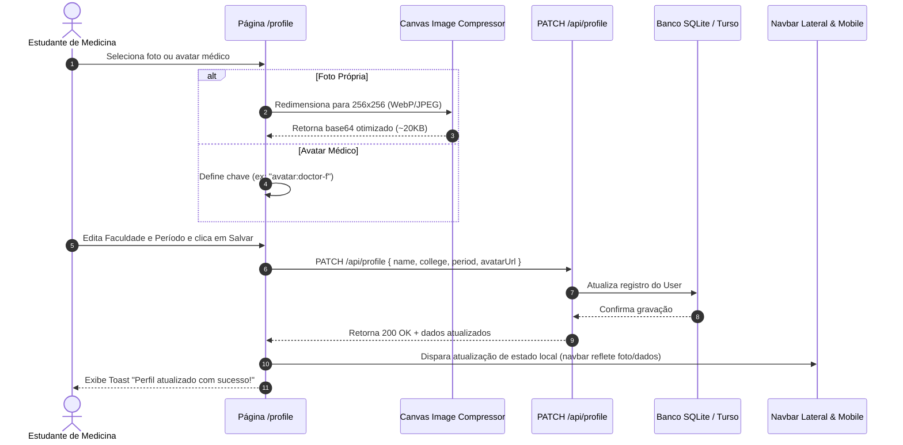

# Especificação Técnica: Perfil do Estudante de Medicina (Fase 1)

**Data:** 27 de Setembro de 2026  
**Status:** Aprovado para Planejamento  
**Escopo:** Fase 1 — Aba de Perfil Acadêmico e Identidade Visual (preparatório para o Ranking / Leaderboard)  

---

## 1. Visão Geral e Objetivos

O **Synapse Quiz** é uma plataforma focada em estudantes de medicina (Ciclo Básico, Clínico, Internato e preparação para Residência/Revalida). Para aumentar o engajamento diário, senso de pertencimento e preparar o ecossistema para a funcionalidade de Ranking entre usuários, esta especificação define a implementação da **Aba de Perfil do Estudante (`/profile`)**.

### Objetivos Principais:
1. **Identidade Acadêmica:** Permitir que o aluno informe sua **Faculdade de Medicina**, seu **Período Acadêmico** (do 1º ao 12º período ou Formado/Residência) e sua **Especialidade dos Sonhos**.
2. **Foto & Avatares Médicos:** Proporcionar personalização visual imediata através de upload de foto própria (com compressão no cliente via Canvas) ou seleção de avatares médicos pré-definidos.
3. **Visibilidade Contínua:** Integrar a foto e dados do aluno na barra lateral desktop e no cabeçalho mobile em tempo real.
4. **Alinhamento com Gamificação:** Exibir métricas de estudo (streak diário, questões resolvidas e acurácia) diretamente no crachá do aluno.

---

## 2. Modelo de Dados (Prisma & SQLite/Turso)

### 2.1 Alterações no Modelo `User` (`prisma/schema.prisma`)
Adição de 4 campos opcionais ao modelo `User`:

```prisma
model User {
  id           String   @id @default(uuid())
  name         String
  email        String   @unique
  passwordHash String
  referralCode String   @unique
  referredById String?
  plan         String   @default("free")

  // Novos campos de identidade médica e perfil
  avatarUrl       String?  // Data URL base64 comprimida (WebP/JPEG ~20KB) ou ID de avatar pré-definido ("avatar:doctor-m", etc.)
  college         String?  // Nome da universidade / faculdade de medicina (ex: "USP", "UNIFESP", "UFRJ")
  period          String?  // "1º Período" a "12º Período" | "Formado / Residência"
  targetSpecialty String?  // Especialidade médica pretendida (ex: "Cardiologia", "Cirurgia Geral")

  stripeCustomerId     String? @unique
  stripeSubscriptionId String? @unique

  referredBy User?  @relation("UserReferrals", fields: [referredById], references: [id])
  referrals  User[] @relation("UserReferrals")

  createdAt DateTime @default(now())
  updatedAt DateTime @updatedAt

  streakCount    Int      @default(0)
  lastActiveDate String?

  reviews      UserCardReview[]
  dailyUsage   DailyUsage[]
  bookmarks    Bookmark[]
  subscription Subscription?
  notes        QuestionNote[]
  reports      QuestionReport[]
  answerLogs   AnswerLog[]
  simulations  Simulation[]
}
```

### 2.2 Migração de Banco de Dados
- Execução de `npx prisma db push` para aplicar os novos campos no banco local e Turso sem perda de dados existentes.
- Contas antigas preservam compatibilidade com valores `null` padrão.

---

## 3. Endpoints de API

### 3.1 `GET /api/profile`
Recupera os dados completos do estudante autenticado e suas métricas consolidadas.

- **Autenticação:** Cookie de sessão JWT (verificado via `getCurrentUser(req)`).
- **Resposta (200 OK):**
```json
{
  "user": {
    "id": "uuid",
    "name": "Lucas Silva",
    "email": "lucas@exemplo.com",
    "avatarUrl": "avatar:doctor-m",
    "college": "Universidade de São Paulo (USP)",
    "period": "5º Período",
    "targetSpecialty": "Neurologia",
    "plan": "free",
    "referralCode": "SYNAPSE123"
  },
  "stats": {
    "streak": 7,
    "totalAnswered": 142,
    "accuracy": 78
  }
}
```

### 3.2 `PATCH /api/profile`
Atualiza os dados de perfil do usuário.

- **Corpo da Requisição:**
```json
{
  "name": "Lucas Silva",
  "college": "Universidade de São Paulo (USP)",
  "period": "5º Período",
  "targetSpecialty": "Neurologia",
  "avatarUrl": "avatar:doctor-m"
}
```
- **Regras de Validação:**
  - `name`: string de 2 a 100 caracteres.
  - `college`: string de até 120 caracteres ou null/vazio.
  - `period`: deve ser um dos valores permitidos (`"1º Período"` até `"12º Período"`, ou `"Formado / Residência"`), ou null/vazio.
  - `targetSpecialty`: string de até 100 caracteres ou null/vazio.
  - `avatarUrl`: string válida de até 150KB (suporta identificador de avatar pronto ou base64 otimizado).
- **Resposta:**
  - `200 OK`: dados atualizados com sucesso.
  - `400 Bad Request`: dados fora do padrão.
  - `401 Unauthorized`: sessão ausente ou inválida.

### 3.3 Atualização em `GET /api/auth/me`
Adicionar os campos `avatarUrl`, `college` e `period` no payload retornado para que o layout e a navbar renderizem a foto e status sem requisições adicionais.

---

## 4. Frontend e Interface do Usuário

### 4.1 Nova Página: `/profile` (`src/app/profile/page.tsx`)
A página adota o design system clínico (tons de teal, zinc e slate, sem elementos infantis de gamificação).

#### Seções da Tela:
1. **Crachá Digital Médico (Identity Card):**
   - Avatar grande (88x88px) com anel de destaque (verde-azulado clínico no Free, dourado suave no PRO).
   - Botão de ação rápida sobre o avatar para trocar imagem.
   - Nome do estudante em destaque tipográfico.
   - Tag estilizada com `Faculdade • Período`.
   - Três cards compactos de métricas clínicas:
     - 🔥 **Sequência:** X dias ativos
     - 🎯 **Questões Feitas:** Total de resoluções
     - 📊 **Acurácia:** Taxa percentual de acertos
2. **Modal / Seletor de Foto e Avatares:**
   - **Upload de Foto Pessoal:**
     - Leitor de arquivo com redimensionamento automático no cliente via HTML5 Canvas (256x256 WebP/JPEG, ~20KB).
     - Preview circular antes de confirmar.
   - **Galeria de Avatares Médicos Pré-definidos:**
     - 8 avatares com design sofisticado e ícones temáticos da medicina:
       1. `avatar:doctor-m` — Médico Clínico
       2. `avatar:doctor-f` — Médica Clínica
       3. `avatar:stethoscope` — Jaleco & Estetoscópio
       4. `avatar:brain` — Neuro & Sinapse
       5. `avatar:microscope` — Microscópio & Diagnóstico
       6. `avatar:heart` — Cardio & Pulso
       7. `avatar:caduceus` — Caduceu da Medicina
       8. `avatar:surgery` — Bisturi & Cirurgia
3. **Formulário de Dados Acadêmicos:**
   - **Nome:** Input editável.
   - **Faculdade de Medicina:** Input com `datalist` contendo as principais escolas médicas brasileiras (USP, UNIFESP, UFRJ, UFMG, UNICAMP, UERJ, UFPR, UFC, etc.) permitindo digitação livre.
   - **Período:** Seleção agrupada:
     - *Ciclo Básico:* 1º ao 4º Período
     - *Ciclo Clínico:* 5º ao 8º Período
     - *Internato Médico:* 9º ao 12º Período
     - *Pós-graduação / Mercado:* Formado / Residência / Revalida
   - **Especialidade Desejada:** Campo aberto para especialidade-alvo.
   - **Feedback Visual:** Botão primário com estado de carregamento e confirmação via `Toaster`.

### 4.2 Integração na Barra Lateral (`src/components/navbar.tsx`)
- **Navegação:** Adicionar item `Meu Perfil` na lista de links com ícone `User`.
- **Rodapé:**
  - O avatar redondo no rodapé (estados recolhido e expandido) exibe a foto do usuário ou o avatar médico selecionado (com fallback para inicial se não definido).
  - Clique no avatar ou no card de usuário navega diretamente para `/profile`.
  - No estado expandido, exibe a faculdade/período abaixo do nome (ex: `USP • 5º Período`), reforçando a identidade médica em qualquer página.

---

## 5. Fluxo de Dados e Reatividade



---

## 6. Plano de Verificação e Testes

1. **Migração do Banco de Dados:**
   - Executar `npx prisma db push` e verificar integridade da tabela `User`.
2. **Testes de API:**
   - `GET /api/profile`: testar com usuário autenticado e sem autenticação (deve retornar 401).
   - `PATCH /api/profile`: testar atualização com avatar médico, com foto em base64, e com dados inválidos.
3. **Testes de Interface e Usabilidade:**
   - Acessar `/profile` em Desktop e Mobile.
   - Selecionar um avatar médico pronto e salvar -> verificar se atualizou na sidebar e no crachá.
   - Fazer upload de uma foto da galeria -> verificar compressão e renderização nítida.
   - Preencher faculdade e período -> verificar se aparece formatado no crachá e no rodapé da barra lateral.
4. **Build & Lint:**
   - Executar `npm run build` para garantir zero erros de TypeScript e Next.js.
